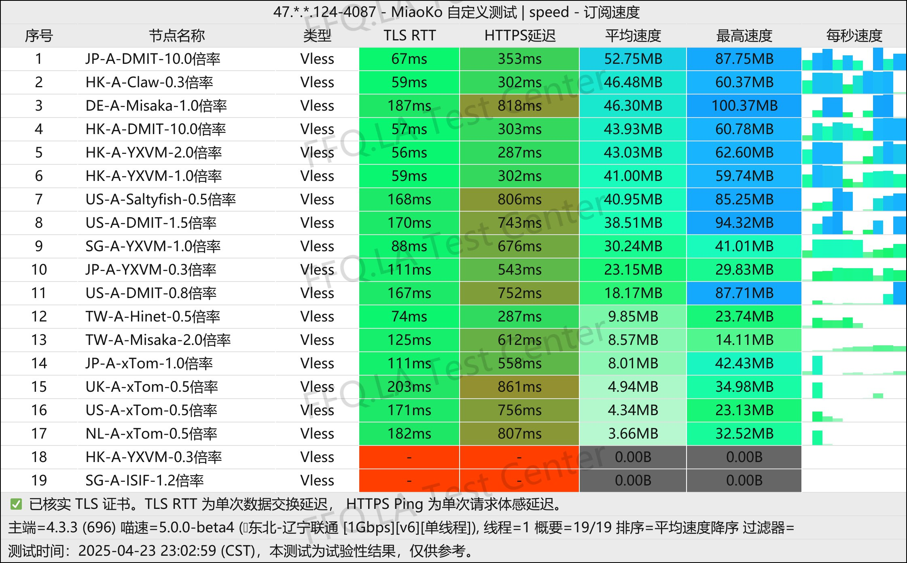
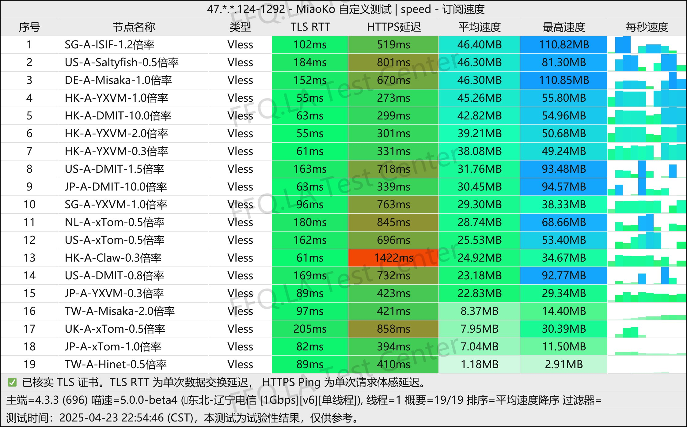
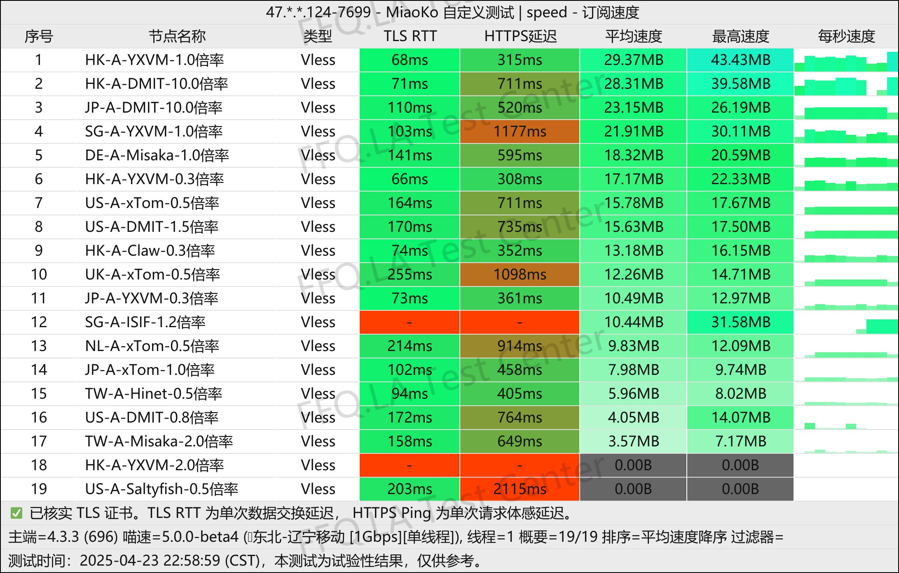
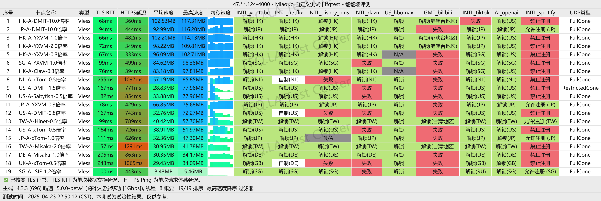
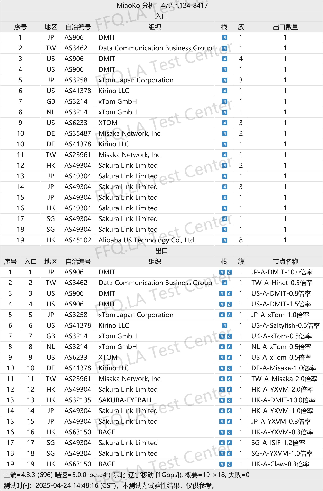

🇨🇳 [中文](README.md) | 🇺🇸 English | 🇷🇺 [Русский](README_RU.md) | 🇮🇷 [فارسی](README_FA.md)

### CTC.run VPN Official Website (Updated November 12, 2026)

Official CTC.run VPN Website<br>
Latest URL 01: [www.ctc.run](https://to.iix.im/ctc03)<br>
Latest URL 02: [www.ctc.run](https://to.iix.im/ctc02)<br>
Official URL: [daohang.ctc.run](https://to.iix.im/ctc01)<br>

Best VPN Recommendations and Server List for 2026: [https://github.com/jdnei/JiChangTuiJian](https://github.com/jdnei/JiChangTuiJian)<br>

## Telegram VPN Deals & Community #AD
[VPN Giveaways](https://331024.de/archives/choujiang) | [VPN Chat Group](https://331024.de/archives/choujiang) | [VPN Trial Group](https://331024.de/archives/choujiang)<br>

[https://331024.de/archives/choujiang](https://331024.de/archives/choujiang)

## Overview
CTC.run VPN is a network service provider focused on **affordability** and **simplicity**.

Known in the VPN community for its low-profile and reliable approach, CTC.run is particularly suitable for users who want to get connected quickly without spending time on complicated configurations.

## Invitation Code

`Register with the invitation code to receive a 0.5× traffic multiplier. According to the promotion description, 50 GB of actual usage consumes only 10 GB of your plan allowance.`

```bash
QSvfat7f
```

## Pricing Plans

[CTC.run](https://www.ctc.run/#/register?code=QSvfat7f) offers affordable pricing and a variety of flexible subscription options:

| Plan Name | Price | Billing Cycle | Monthly Data | Speed Limit | IP Limit | Network Features |
| :--- | :--- | :--- | :--- | :--- | :--- | :--- |
| **Qi Refining (Foundation)** | ¥35.00 | 6 Months | 25 GB | No Speed Cap | 3 IPs | Traffic multiplier as low as 0.5×; multiple network routes |
| **Qi Refining** | ¥72.00 | 6 Months | 100 GB | 300 Mbps | 5 IPs | Mixed CN2 / 9929 / CMI routes |
| **Foundation Establishment** | ¥180.00 | 6 Months | 300 GB | 500 Mbps | 5 IPs | Mixed CN2 / 9929 / CMI routes |
| **Golden Core** | ¥320.00 | 6 Months | 800 GB | 1 Gbps | 5 IPs | High bandwidth; flagship-level experience |
| **Qi Refining C40** | ¥75.00 | 3 Months | 100 GB | No Speed Cap | 3 IPs | **Optimized for Three Major Carriers:** CMIN2 / 9929 / GIA |
| **Qi Refining C10** | ¥85.00 | 6 Months | 100 GB | 500 Mbps | 3 IPs | **China Mobile Optimization:** All routes via CMI |
| **Qi Refining C20** | ¥120.00 | 6 Months | 100 GB | 500 Mbps | 3 IPs | **China Unicom Optimization:** 4837 / 9929 routes |
| **Qi Refining C30-100G** | ¥10.00 | Monthly | 100 GB | 300 Mbps | 3 IPs | **US-Focused Plan:** US-only servers |
| **Qi Refining C30-500G** | ¥40.00 | Monthly | 500 GB | 500 Mbps | 3 IPs | **US-Focused Plan:** US-only servers |

## 📊 Performance Tests & Analysis

#### 1.1 China Unicom Evening Peak-Hour Speed Test
<br>

#### 1.2 China Telecom Evening Peak-Hour Speed Test
<br>

#### 1.3 China Mobile Evening Peak-Hour Speed Test
<br>

#### 2. Streaming Service Unblocking Report
<br>

#### 3. Entry and Exit Node Analysis
<br>
