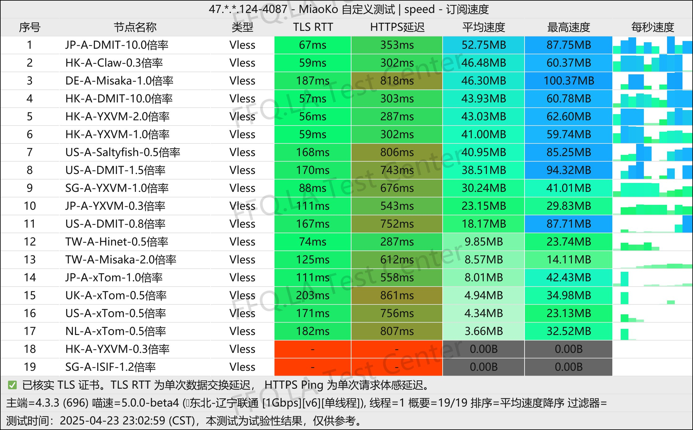
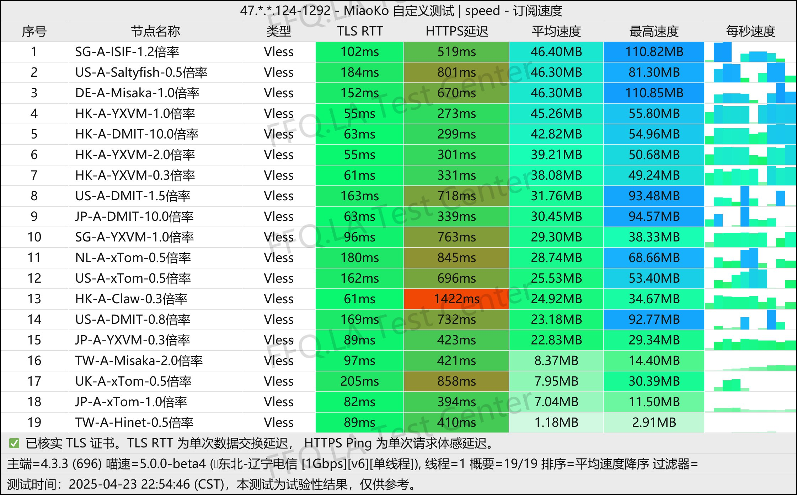
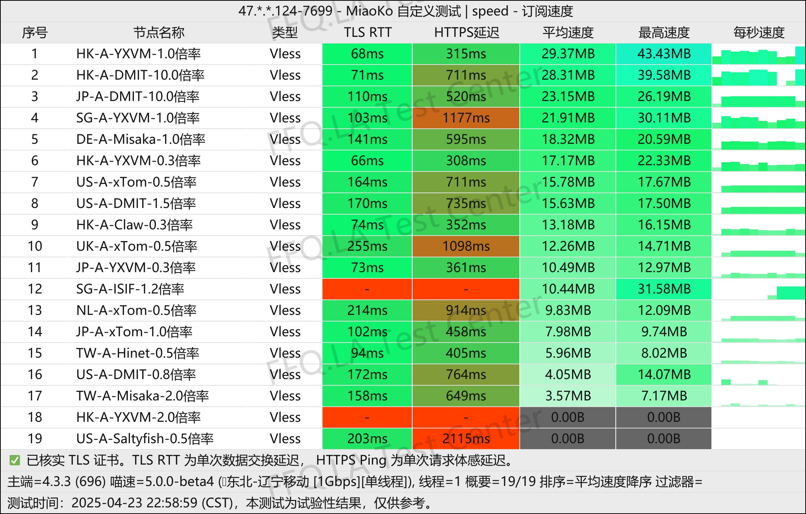
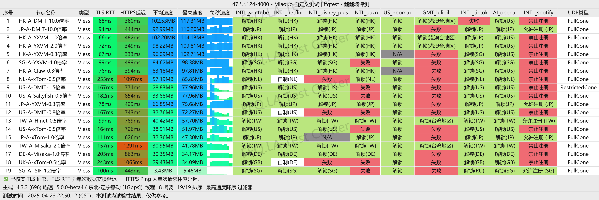
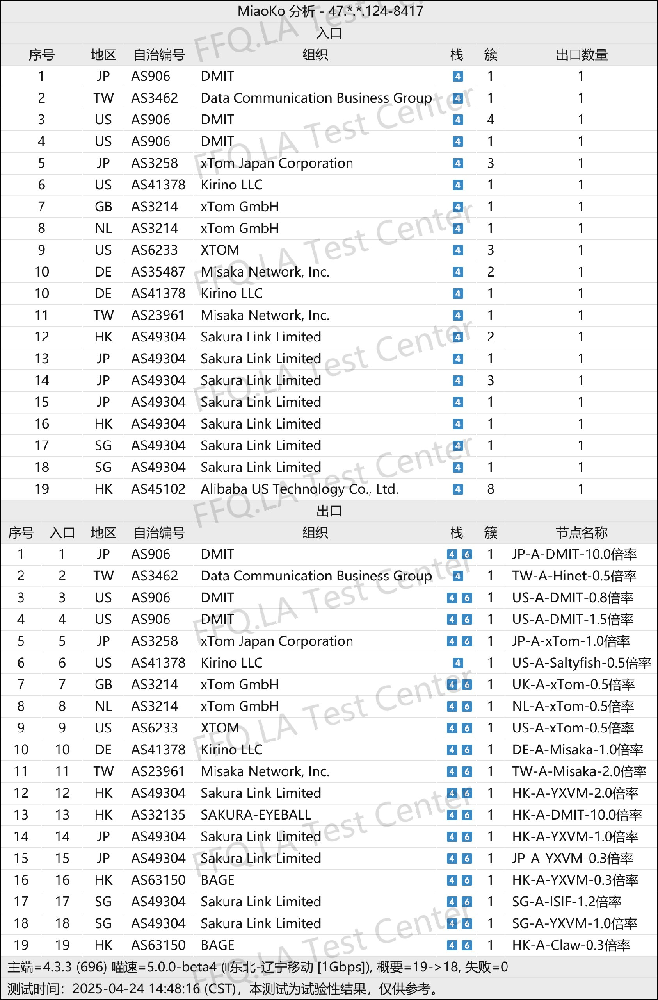

 🇨🇳 [中文](README.md) | 🇺🇸 [English](README_EN.md) | 🇷🇺 [Русский](README_RU.md) | 🇮🇷 فارسی

### وب‌سایت رسمی CTC.run VPN  (به‌روزرسانی 7 نوامبر 2026)
وب‌سایت رسمی CTC.run VPN<br>
آخرین آدرس ۰۱: [www.ctc.run](https://to.iix.im/ctc03)<br>
آخرین آدرس ۰۲: [www.ctc.run](https://to.iix.im/ctc02)<br>
آدرس رسمی: [daohang.ctc.run](https://to.iix.im/ctc01)<br>

معرفی بهترین سرویس‌ها و سرورهای VPN در سال ۲۰۲۶: [https://github.com/jdnei/JiChangTuiJian](https://github.com/jdnei/JiChangTuiJian)<br>

## انجمن و پیشنهادهای ویژه VPN در تلگرام #AD
[قرعه‌کشی VPN](https://331024.de/archives/choujiang) | [گروه گفت‌وگوی VPN](https://331024.de/archives/choujiang) | [گروه آزمایش VPN](https://331024.de/archives/choujiang)<br>

[https://331024.de/archives/choujiang](https://331024.de/archives/choujiang)

## معرفی
CTC.run VPN یک ارائه‌دهنده خدمات شبکه است که بر **قیمت مقرون‌به‌صرفه** و **سادگی استفاده** تمرکز دارد.

این سرویس در جامعه کاربران VPN به رویکرد کم‌حاشیه و قابل‌اعتماد خود شناخته می‌شود و به‌ویژه برای افرادی مناسب است که می‌خواهند بدون صرف وقت برای تنظیمات پیچیده، به‌سرعت به اینترنت متصل شوند.

## کد دعوت

`با ثبت‌نام از طریق کد دعوت، ضریب محاسبه ترافیک ۰٫۵× دریافت می‌کنید. طبق توضیحات این پیشنهاد، مصرف واقعی ۵۰ گیگابایت تنها ۱۰ گیگابایت از حجم بسته شما را کسر می‌کند.`

```bash
QSvfat7f
```

## طرح‌های اشتراک

[CTC.run](https://www.ctc.run/#/register?code=QSvfat7f) طرح‌های متنوع و انعطاف‌پذیری با قیمت مناسب ارائه می‌کند:

| نام طرح | قیمت | دوره پرداخت | حجم ماهانه | محدودیت سرعت | محدودیت IP | ویژگی‌های شبکه |
| :--- | :--- | :--- | :--- | :--- | :--- | :--- |
| **پالایش چی (تقویت پایه)** | ¥35.00 | شش‌ماهه | 25 GB | بدون محدودیت سرعت | ۳ IP | ضریب ترافیک تا حداقل ۰٫۵×؛ دسترسی از چندین مسیر شبکه |
| **پالایش چی** | ¥72.00 | شش‌ماهه | 100 GB | 300 Mbps | ۵ IP | مسیرهای ترکیبی CN2 / 9929 / CMI |
| **بنیان‌گذاری** | ¥180.00 | شش‌ماهه | 300 GB | 500 Mbps | ۵ IP | مسیرهای ترکیبی CN2 / 9929 / CMI |
| **هسته زرین** | ¥320.00 | شش‌ماهه | 800 GB | 1 Gbps | ۵ IP | پهنای باند بالا؛ تجربه‌ای در سطح پرچم‌دار |
| **پالایش چی C40** | ¥75.00 | سه‌ماهه | 100 GB | بدون محدودیت سرعت | ۳ IP | **بهینه‌سازی برای سه اپراتور اصلی:** CMIN2 / 9929 / GIA |
| **پالایش چی C10** | ¥85.00 | شش‌ماهه | 100 GB | 500 Mbps | ۳ IP | **بهینه‌سازی برای China Mobile:** تمام مسیرها از طریق CMI |
| **پالایش چی C20** | ¥120.00 | شش‌ماهه | 100 GB | 500 Mbps | ۳ IP | **بهینه‌سازی برای China Unicom:** مسیرهای 4837 / 9929 |
| **پالایش چی C30-100G** | ¥10.00 | ماهانه | 100 GB | 300 Mbps | ۳ IP | **طرح ویژه آمریکا:** فقط سرورهای ایالات متحده |
| **پالایش چی C30-500G** | ¥40.00 | ماهانه | 500 GB | 500 Mbps | ۳ IP | **طرح ویژه آمریکا:** فقط سرورهای ایالات متحده |

## 📊 آزمایش عملکرد و تحلیل

#### 1.1 آزمایش سرعت China Unicom در ساعات اوج مصرف شبانه
<br>

#### 1.2 آزمایش سرعت China Telecom در ساعات اوج مصرف شبانه
<br>

#### 1.3 آزمایش سرعت China Mobile در ساعات اوج مصرف شبانه
<br>

#### 2. گزارش رفع محدودیت سرویس‌های پخش آنلاین
<br>

#### 3. تحلیل سرورهای ورودی و خروجی
<br>
