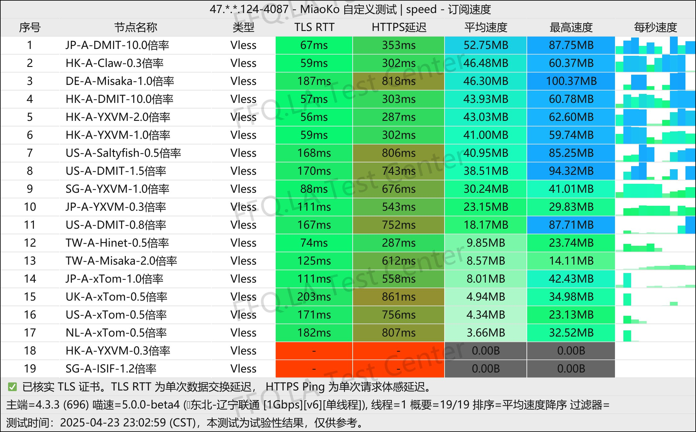
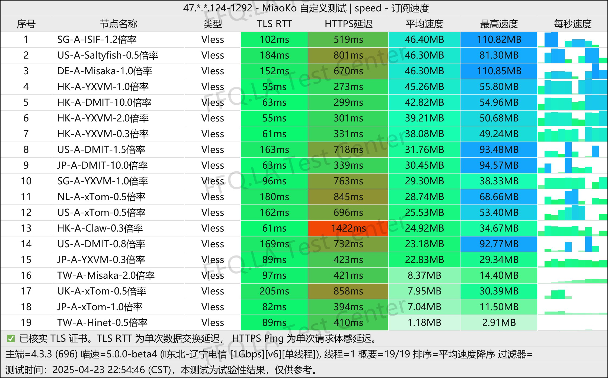
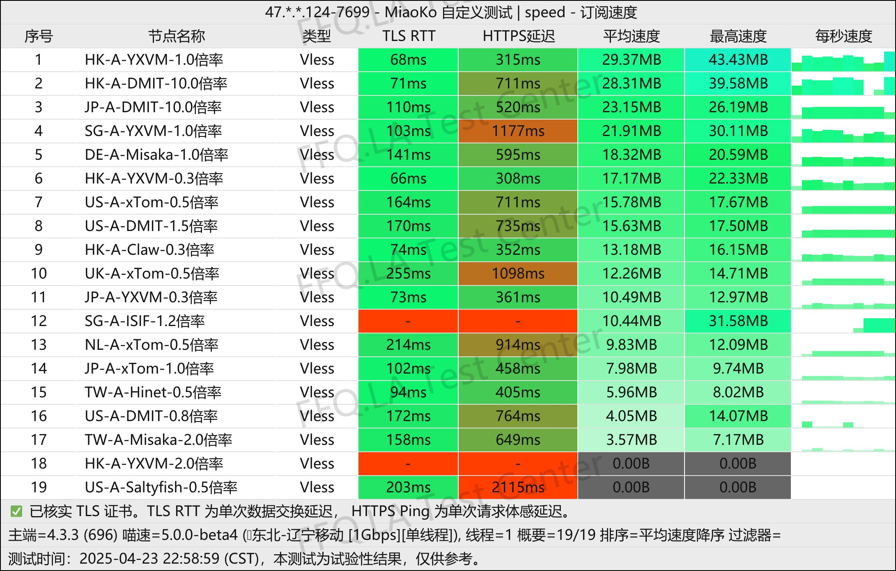
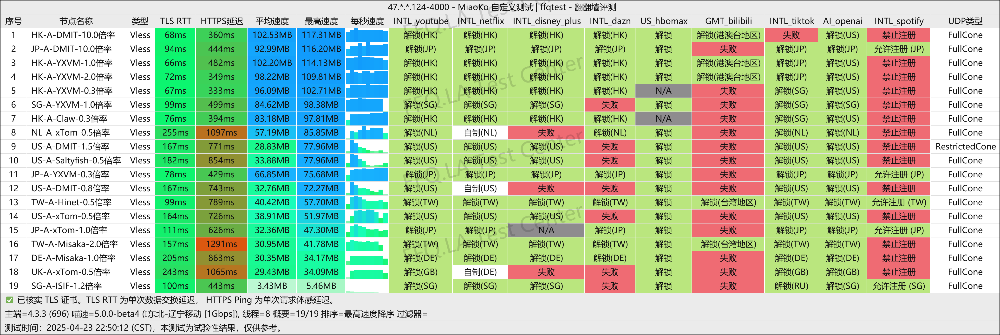
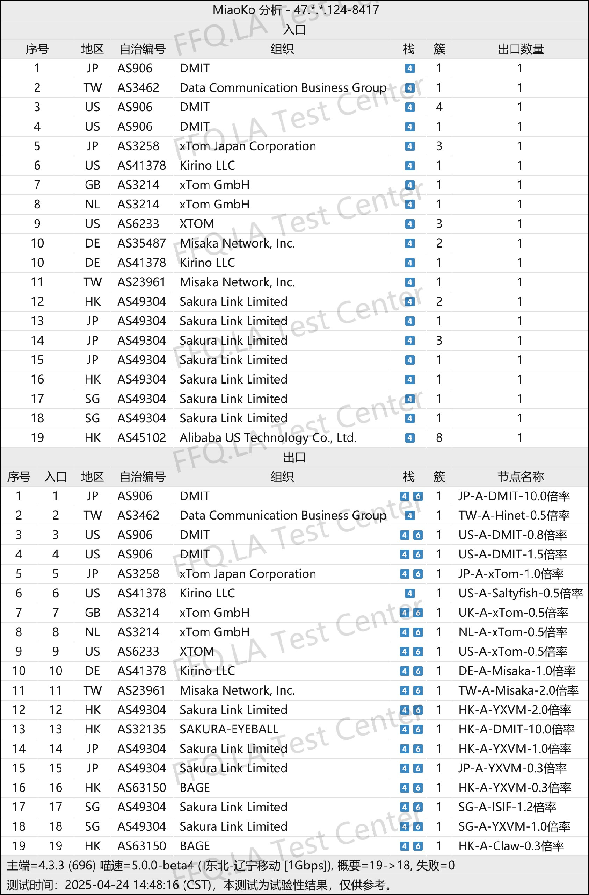

🇨🇳 [中文](README.md) | 🇺🇸 [English](README_EN.md) | 🇷🇺 Русский | 🇮🇷 [فارسی](README_FA.md)

### Официальный сайт CTC.run VPN (обновлено 14 ноября 2026)

Официальный сайт CTC.run VPN<br>
Актуальный адрес 01: [www.ctc.run](https://to.iix.im/ctc03)<br>
Актуальный адрес 02: [www.ctc.run](https://to.iix.im/ctc02)<br>
Официальный адрес: [daohang.ctc.run](https://to.iix.im/ctc01)<br>

Лучшие VPN-сервисы и серверы на 2026 год: [https://github.com/jdnei/JiChangTuiJian](https://github.com/jdnei/JiChangTuiJian)<br>

## Telegram: VPN-сообщество и специальные предложения #AD
[Розыгрыши VPN](https://331024.de/archives/choujiang) | [Чат о VPN](https://331024.de/archives/choujiang) | [Группа тестирования VPN](https://331024.de/archives/choujiang)<br>

[https://331024.de/archives/choujiang](https://331024.de/archives/choujiang)

## Обзор
CTC.run VPN — провайдер сетевых услуг, ориентированный на **доступные цены** и **максимальную простоту использования**.

В VPN-сообществе сервис известен своим сдержанным и надёжным подходом. Он особенно подходит пользователям, которые хотят быстро начать работу, не тратя время на сложные настройки.

## Пригласительный код

`При регистрации по пригласительному коду предоставляется коэффициент учёта трафика 0,5×. Согласно описанию акции, фактическое использование 50 ГБ приводит к списанию всего 10 ГБ из тарифного лимита.`

```bash
QSvfat7f
```

## Тарифные планы

[CTC.run](https://www.ctc.run/#/register?code=QSvfat7f) предлагает доступные цены и разнообразные гибкие тарифные планы:

| Название тарифа | Цена | Период оплаты | Трафик в месяц | Ограничение скорости | Лимит IP | Особенности сети |
| :--- | :--- | :--- | :--- | :--- | :--- | :--- |
| **Очищение ци (Укрепление основы)** | ¥35.00 | 6 месяцев | 25 ГБ | Без ограничения скорости | 3 IP | Коэффициент учёта трафика от 0,5×; несколько сетевых маршрутов |
| **Очищение ци** | ¥72.00 | 6 месяцев | 100 ГБ | 300 Мбит/с | 5 IP | Смешанные маршруты CN2 / 9929 / CMI |
| **Закладка основы** | ¥180.00 | 6 месяцев | 300 ГБ | 500 Мбит/с | 5 IP | Смешанные маршруты CN2 / 9929 / CMI |
| **Золотое ядро** | ¥320.00 | 6 месяцев | 800 ГБ | 1 Гбит/с | 5 IP | Высокая пропускная способность; возможности флагманского уровня |
| **Очищение ци C40** | ¥75.00 | 3 месяца | 100 ГБ | Без ограничения скорости | 3 IP | **Оптимизация для трёх крупнейших операторов:** CMIN2 / 9929 / GIA |
| **Очищение ци C10** | ¥85.00 | 6 месяцев | 100 ГБ | 500 Мбит/с | 3 IP | **Оптимизация для China Mobile:** все маршруты через CMI |
| **Очищение ци C20** | ¥120.00 | 6 месяцев | 100 ГБ | 500 Мбит/с | 3 IP | **Оптимизация для China Unicom:** маршруты 4837 / 9929 |
| **Очищение ци C30-100G** | ¥10.00 | Месяц | 100 ГБ | 300 Мбит/с | 3 IP | **Специализация на США:** только американские серверы |
| **Очищение ци C30-500G** | ¥40.00 | Месяц | 500 ГБ | 500 Мбит/с | 3 IP | **Специализация на США:** только американские серверы |

## 📊 Тесты производительности и анализ

#### 1.1 Тест скорости China Unicom в вечерние часы пик
<br>

#### 1.2 Тест скорости China Telecom в вечерние часы пик
<br>

#### 1.3 Тест скорости China Mobile в вечерние часы пик
<br>

#### 2. Отчёт о разблокировке стриминговых сервисов
<br>

#### 3. Анализ входных и выходных узлов
<br>
